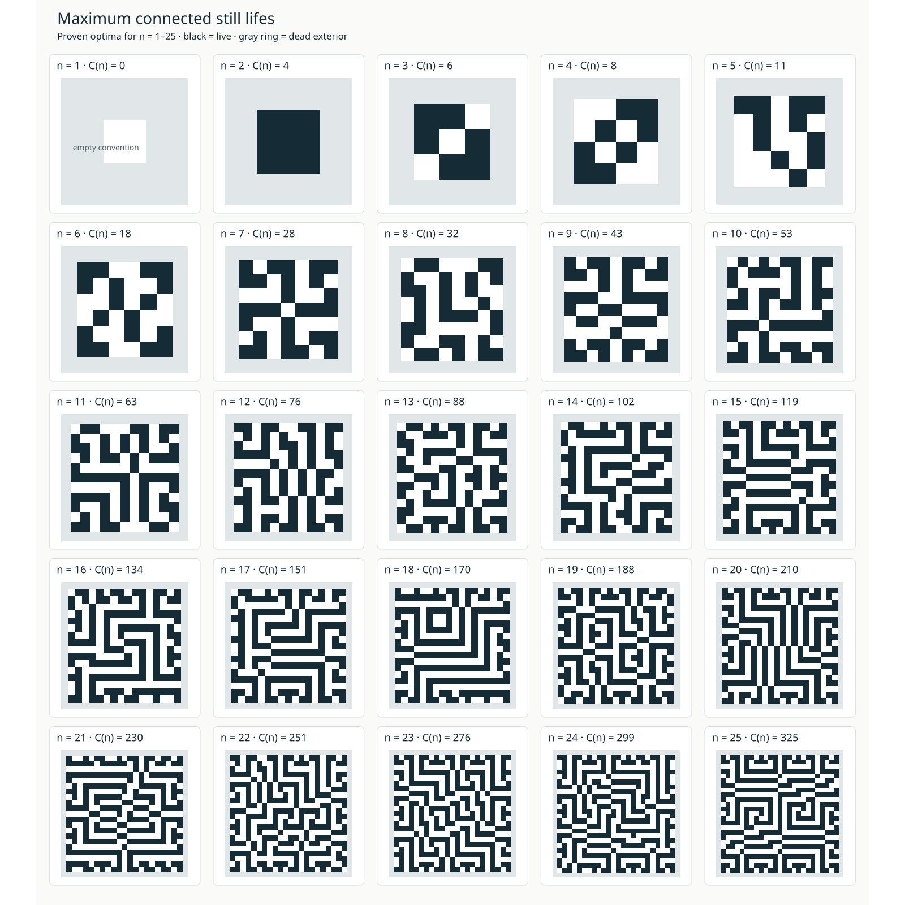

# Maximum connected still lifes

Let C(n) be the maximum population of a Conway still life contained in an n × n
square, with all live cells connected by king moves (diagonals included) and
an infinite dead exterior. Empty margins are allowed. Set C(1)=0 because no
nonempty still life fits.

The proven consecutive terms, n=1,...,25, are

```text
0,4,6,8,11,18,28,32,43,53,63,76,88,102,119,134,151,170,188,210,230,251,276,299,325
```

Also exact: C(31)=497, C(32)=528, C(33)=562, C(39)=782.
The next open term satisfies 349 ≤ C(26) ≤ 352.



[Open the full-resolution vector plate](docs/optima_1_25.svg).

## Bounds and constructions

For every n ≥ 14,

```text
C(n) ≤ floor((4n² + 5n − d[n mod 8])/8),
d = [26,23,18,23,20,23,26,11].
```

This is an upper bound, not an exact formula. Intersect it with the published
unrestricted still-life maximum where available; finite exclusions improve
five sizes. Matching connected boards establish all exact values listed above.

The repository also contains pond, capped period-eight brick, and period-54
lower-bound generators. The period-54 family has
C(100+54k) ≥ (100+54k)²/2 + 26k + 51 for every k ≥ 0. These families are not
claimed optimal. See [the mathematics and formulas](docs/MATHEMATICS.md),
[all bounds through 50](docs/RESULTS.md), and the [proof index](data/proof_index.json).

## Verify

Use Python 3.11+, NumPy, and a C++20 compiler for row-proof regeneration.

```sh
python -m pip install -r requirements.txt
python -B scripts/audit_release.py --replay-small
```

This checks all 49 boards with two verifiers, the bound ledger, certificates,
checksums, and complete small row proofs. Larger exhaustive proofs have separate
[reproduction commands](docs/REPRODUCING.md). A quick certificate audit is not a
substitute for those full computations. See [validation scope](docs/VALIDATION.md).

## Repository contents

| Folder | Purpose |
|:---|:---|
| `constructions/` | One board per size, serving as the lower-bound certificate |
| `certificates/` | Row, boundary, finite-exclusion and generator certificates |
| `scripts/`, `src/`, `verifiers/` | Regeneration algorithms, shared boundary engines and board checks |
| `data/` | Bounds, exact-prefix b-file, proof index and generator seeds |
| `docs/` | Mathematics, reproduction, references, OEIS draft and the illustrated plate |
| `tests/` | Verifier, row-enumeration and cycle-support regression tests |

This folder is the repository root to publish. Generated files go in ignored
`build/`. No manuscript or external verifier service is required.
The [OEIS draft](docs/OEIS_DRAFT.md) needs human review and the final repository URL.

## Acknowledgments

Siddhartha Mahajan found the Connected Maximum-density Still Life problem on
the [Fourth ASP Competition's 2013 problem page](https://www.mat.unical.it/aspcomp2013/ConnectedMaximumDensityStillLife),
recognized it as a candidate integer sequence, and directed a computational
investigation with AI assistance that established most of the optimal values
reported in this release. Siddhartha remains responsible for checking and
presenting the results.

We thank [Dr. Ankan Pal](https://www.linkedin.com/in/ankanpal21/)
([Google Scholar](https://scholar.google.com/citations?user=Xb7FSjUAAAAJ&hl=en))
for reviewing the connected-still-life problem page for CAISc.

We acknowledge the [CAISc 2026](https://caisc2026.github.io/) team:

- Organizing committee: [Dr. Dhruv Kumar](https://www.linkedin.com/in/dhruv-kumar-87082b335/),
  [Dhruv Trehan](https://www.linkedin.com/in/dhruvtrehan/),
  [Paras Chopra](https://www.linkedin.com/in/paraschopra/),
  [Siddhartha Mahajan](https://www.linkedin.com/in/siddharthamahajan03/), and
  [Devansh Agarwal](https://www.linkedin.com/in/devansh-agarwal-874605180/).
- Program chairs: [Dr. Pratik Narang](https://www.linkedin.com/in/pratik-narang/)
  and [Dr. Murari Mandal](https://www.linkedin.com/in/murari-mandal/).
- Co-organizers: [Lossfunk](https://lossfunk.com/) and
  [BITS Pilani](https://www.bits-pilani.ac.in/).

These roles and profile links follow the official
[CAISc team page](https://caisc2026.github.io/team.html). We thank the
participating researchers whose papers informed this work.
[References and attribution](docs/REFERENCES.md) link the papers with their
verified authors. Acknowledgment does not imply authorship or endorsement.
